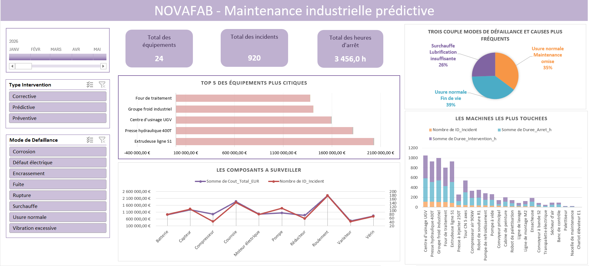

# NOVAFAB — Maintenance industrielle prédictive

Dashboard Excel de suivi de la maintenance industrielle, conçu pour visualiser les incidents, les arrêts machines et les équipements les plus critiques.

## Présentation

Ce tableau de bord Excel rassemble plusieurs indicateurs de maintenance dans une vue synthétique. Il aide à repérer les équipements prioritaires, suivre les modes de défaillance et comparer les coûts aux incidents déclarés.

## Fonctionnalités

- **Indicateurs clés** : nombre total d’équipements, nombre total d’incidents et heures d’arrêt cumulées.
- **Filtres interactifs** : période, type d’intervention et mode de défaillance.
- **Top 5 des équipements les plus critiques** : classement visuel des équipements selon le coût total.
- **Composants à surveiller** : comparaison de l’évolution du coût total et du nombre d’incidents par composant.
- **Modes de défaillance et causes fréquentes** : répartition des principales causes identifiées.
- **Machines les plus touchées** : comparaison du nombre d’incidents, des heures d’arrêt et des heures d’intervention.

## Aperçu des indicateurs

Les valeurs visibles sur la capture d’écran sont un exemple de lecture du tableau de bord et peuvent varier selon les filtres et les données du classeur.

| Indicateur | Valeur affichée sur la capture |
|---|---:|
| Total des équipements | 24 |
| Total des incidents | 920 |
| Total des heures d’arrêt | 3 456,0 h |

## Technologies et outils

- **Microsoft Excel**
- Tableaux croisés dynamiques, graphiques et filtres/segments Excel, selon la configuration du classeur
- Données de maintenance industrielle : interventions, incidents, coûts et durées d’arrêt

> Remarque : les éléments ci-dessus décrivent les fonctionnalités visibles sur le dashboard. Adaptez la liste des outils à la manière dont votre fichier Excel a réellement été construit.

## Utilisation

1. Téléchargez ou clonez ce dépôt.
2. Ouvrez le classeur Excel associé au projet.
3. Actualisez les données si nécessaire.
4. Utilisez les filtres pour explorer les périodes, types d’intervention et modes de défaillance.
5. Analysez les équipements et composants prioritaires afin d’orienter les actions de maintenance.

## Objectif du projet

Faciliter le pilotage de la maintenance industrielle grâce à une visualisation centralisée des incidents, des coûts et des arrêts, afin d’aider à identifier les équipements nécessitant une attention prioritaire.